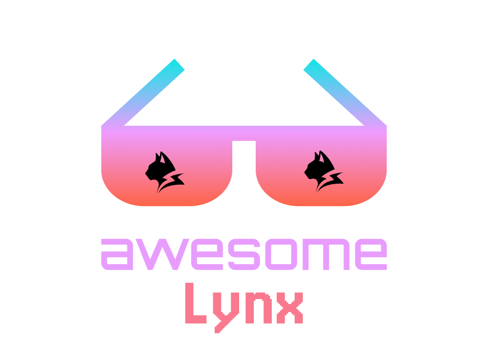

# Awesome Lynx 

> A curated list of awesome lynx ecosystem

## Contents

- [Lynx Family](#lynx-family)
- [Community Showcase](#community-showcase)
- [UI Libraries](#ui-libraries)
- [Tooling](#tooling)
- [Templates](#templates)

## Lynx Family

- [Lynx](https://lynxjs.org) - Empower the web community and invite more to build across platforms.
- [PrimJS](https://github.com/lynx-family/primjs) - PrimJS is a lightweight, high-performance JavaScript engine designed specifically for the Lynx cross-platform framework.
- [React Lynx](https://lynxjs.org/react) - [**ReactLynx**](https://lynxjs.org/react/) is a framework that allows you to build cross-platform [**Lynx**](https://lynxjs.org/) apps with [**React**](https://react.dev/) paradigm.
- [Rspeedy](https://lynxjs.org/rspeedy) - The Rspack-based build tool for Lynx.
- [Lynx devtool](https://github.com/lynx-family/lynx-devtool) - An Electron-based developer tool for Lynx, providing mobile debugging features.
- [Lynx Web](https://github.com/lynx-family/lynx-stack/tree/main/packages/web-platform) - The Lynx's Web Platform is an implementation for Lynx's native binding APIs based on Browser APIs.

## Community Showcase

- [Vue Lynx](https://vue.lynxjs.org) - [**VueLynx**](https://github.com/Huxpro/vue-lynx) is a framework that allows you to build cross-platform [**Lynx**](https://lynxjs.org/) apps with [**Vue**](https://vuejs.org/) paradigm.
- [Miso Lynx](https://github.com/haskell-miso/miso-lynx), build native mobile applications with [**Haskell**](https://haskell.org) [**miso**](https://github.com/dmjio/miso) and [**Lynx JS**](https://lynxjs.org/).

## UI Libraries

- [Lynx UI](https://github.com/lynx-family/lynx-ui) - The official headless UI library for [**ReactLynx**](https://lynxjs.org/react/), unifying platform-divergent component behavior behind one API. Docs: [lynxjs.org/next/ui](https://lynxjs.org/next/ui/).
- [Vy UI](https://github.com/KealanAU/vyui) - Headless primitives and styled components for [**Vue Lynx**](https://vue.lynxjs.org), with a shadcn-style CLI for copying component source into your own project. Docs: [vyui.dev](https://vyui.dev).

## Tooling

- [Tamer4Lynx](https://github.com/tamer4lynx/tamer4lynx) — Developer workflow and native extension ecosystem for Lynx, in an [Expo](https://expo.dev)-like spirit; CLI for scaffolding, linking, and bundling ([Autolink RFC](https://github.com/lynx-family/lynx/discussions/2653)). Docs: [tamer4lynx.github.io](https://tamer4lynx.github.io/).

## Templates

- [Native Map](https://github.com/hpstuff/lynx-map-example) - A simple map app that shows how to use the native binding API by [Rumen Rusanov](https://github.com/hpstuff)

Contributions welcome! Read the [contribution guidelines](contributing.md) first.
